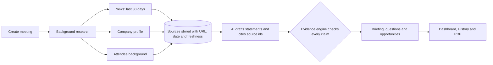

<div align="center">

# 🧠 MeetWise AI

**Walk into every meeting prepared.**
An AI pre-meeting briefing agent that researches the company and the person you are meeting,
then shows you *exactly how much evidence backs every statement*.

`Next.js 16` · `React 19` · `TypeScript` · `Tailwind CSS 4` · `FastAPI` · `SQLAlchemy` · `Tavily` · `LLM (Gemini / Claude / OpenAI-compatible)` · `ReportLab`

Built for the **Global AI Hackathon**

</div>

---

## ✨ What it does

You enter **who** you are meeting, **when**, and **why**. MeetWise AI then:

1. 🔎 Searches the live web: news from the **last 30 days**, the company profile, and the attendee's public professional background
2. 🧾 Stores every source with its **URL, title, publication date and retrieval date**
3. 🤖 Lets an AI model draft insights, opportunities and questions, always citing the sources it used
4. 🛡️ Runs an **evidence engine** that decides how trustworthy each statement is, and flags the weak ones
5. 📄 Produces a personalised **briefing** you can read in the app, keep in history, and download as a **PDF**

## 🏆 What makes it different: the Evidence & Freshness engine

Most AI tools hand you confident text and no way to check it. MeetWise AI **separates retrieved evidence from AI interpretation**, and the AI cannot award itself trust. Labels come from deterministic rules in code:

| Label | When it is given |
|---|---|
| ✅ **Verified** | At least 2 independent websites, strong match with the cited text, at least one recent source, and any numbers in the claim appear in the source |
| 🟡 **Partially supported** | Some support: a single source, undated sources, or a weaker match |
| 🔴 **Needs verification** | No valid source cited, or the cited text does not support the statement |
| 🟠 **Potentially outdated** | Every supporting source is older than its freshness window (news: 30 days, other pages: 1 year) |

Built-in safeguards:

- 🚫 **Invented source ids are discarded.** The AI can only cite sources that really exist.
- 📅 **Missing dates stay unknown.** A publication date is never guessed.
- 🧠 **AI interpretations can never be "Verified"** and are tagged *AI interpretation*.
- 🕳️ **Gaps are shown, not hidden.** A *Limitations* box lists what could not be found.
- 🔒 **Professional, public information only** for people. If nothing reliable is found, that section is skipped instead of guessed.

## 🧭 How it works



Research runs in the background and the page shows **real progress** (not a fake timer), so you can leave and come back.

## 🧩 Features

| | Feature |
|---|---|
| 📅 | Smart meeting creation, with validation, edit and delete |
| 📰 | 30-day news research with headlines, summaries, dates and links |
| 🏢 | Company intelligence: overview, business model, products, competitors, initiatives, challenges |
| 👤 | People intelligence: role, experience, achievements, expertise, public interviews and articles |
| 📋 | Personalised briefing: insights, opportunities, risks, discussion points, meeting strategy |
| ❓ | Specific questions: strategic, technical, business, collaboration and follow-up, each with *why ask* |
| 💡 | Opportunity intelligence: why it is relevant and which evidence supports it |
| 📄 | Professional PDF export with evidence labels and numbered source references |
| 🗂️ | Meeting history with search, filters, sorting and delete |
| 🧪 | Demo mode on clearly labelled fictional data (no keys needed) |

## 🖼️ Screenshots

> Add screenshots to `docs/screenshots/` and link them here.
>
> `` · ``

## 🚀 Quick start (Windows)

**You need:** [Python 3.11](https://www.python.org/downloads/release/python-3119/) (tick *Add python.exe to PATH*) and [Node.js LTS](https://nodejs.org) (20.9 or newer). Restart your laptop after installing them.

### Option A: one click

1. Put the project in a folder **without spaces**, e.g. `C:\projects\MeetWise-AI`
2. Double-click **`setup.bat`** (one time, 10 to 20 minutes)
3. Double-click **`start.bat`**. Your browser opens <http://localhost:3000>

Non-technical teammates: see [`START-HERE.txt`](START-HERE.txt).

### Option B: manual

**Terminal 1: backend**
```powershell
cd backend
python -m venv venv
venv\Scripts\activate
pip install -r requirements-dev.txt
copy .env.example .env        # then edit .env (see Configuration)
uvicorn app.main:app --reload
```
API docs: <http://127.0.0.1:8000/docs> · Status: <http://127.0.0.1:8000/health>

**Terminal 2: frontend**
```powershell
cd frontend
npm install
npm run dev
```
Open <http://localhost:3000>.

## ⚙️ Configuration (`backend/.env`)

Copy `backend/.env.example` to `backend/.env`. **Never commit `.env`.**

| Setting | Purpose |
|---|---|
| `MOCK_MODE` | `true` runs everything on labelled fictional data (no keys). `false` = real research |
| `TAVILY_API_KEY` | Web search key from [tavily.com](https://tavily.com) |
| `LLM_PROVIDER` | `openai_compatible` (Gemini, OpenAI, Groq, OpenRouter...) or `anthropic` |
| `LLM_API_KEY`, `LLM_BASE_URL`, `LLM_MODEL` | AI provider settings (when `openai_compatible`) |
| `LLM_FALLBACK_MODEL` | Optional backup model, used automatically if the main one is overloaded |
| `ANTHROPIC_API_KEY`, `CLAUDE_MODEL` | Used when `LLM_PROVIDER=anthropic` |
| `DATABASE_URL` | Default `sqlite:///./meetwise.db`. Use a PostgreSQL URL in production |
| `CORS_ORIGINS` | Comma-separated frontend URLs allowed to call the API |

**Example: Google Gemini** (free key at [aistudio.google.com](https://aistudio.google.com))
```ini
MOCK_MODE=false
TAVILY_API_KEY=your-tavily-key
LLM_PROVIDER=openai_compatible
LLM_API_KEY=your-google-key
LLM_BASE_URL=https://generativelanguage.googleapis.com/v1beta/openai
LLM_MODEL=a-current-flash-model-from-your-model-list
LLM_FALLBACK_MODEL=a-different-flash-model
```
Model names change often. List the ones your key can use and time them with:
```powershell
cd backend
python scripts\test_models.py
```

The frontend reads one optional setting, `NEXT_PUBLIC_API_URL` (default `http://127.0.0.1:8000`).

## 🔌 API overview

| Method | Path | Purpose |
|---|---|---|
| `POST` | `/api/meetings` | Create a meeting |
| `GET` | `/api/meetings` | List and search meetings |
| `GET` `PATCH` `DELETE` | `/api/meetings/{id}` | Read, edit, delete (delete removes all its research) |
| `POST` | `/api/meetings/{id}/research` | Start research (runs in the background) |
| `GET` | `/api/meetings/{id}/status` | Stage, progress % and any error |
| `GET` | `/api/meetings/{id}/briefing` | Full briefing with evidence labels and sources |
| `GET` | `/api/meetings/{id}/sources` | Raw evidence list |
| `GET` | `/api/meetings/{id}/news` | News items |
| `GET` | `/api/meetings/{id}/pdf` | Download the PDF |
| `GET` | `/api/history` | History with search, filters, sorting, pagination |
| `GET` | `/api/history/stats` | Dashboard numbers |
| `GET` | `/health` | Backend, database, AI settings and mock-mode status |

Interactive docs live at `/docs`. TypeScript types for these shapes: [`frontend/src/types/api.ts`](frontend/src/types/api.ts).

## 🗂️ Project structure

```
MeetWise-AI/
├── backend/
│   ├── app/
│   │   ├── api/routes/      meeting, research, briefing, history endpoints
│   │   ├── services/        Tavily, AI client, evidence engine, briefing, PDF
│   │   ├── models/          SQLAlchemy tables
│   │   ├── schemas/         Pydantic request and response models
│   │   ├── database/        engine and sessions
│   │   └── utils/
│   ├── tests/               pytest suite
│   ├── scripts/             test_models.py
│   ├── requirements.txt
│   └── .env.example
├── frontend/
│   └── src/                 app (pages), components, hooks, lib, types
├── render.yaml              backend deployment blueprint
├── setup.bat · start.bat    Windows one-click helpers
└── README.md
```

## 🧪 Tests

```powershell
cd backend
pytest -v
```
The tests use **fake search and AI responses**, so they cost nothing and need no keys. They cover meeting CRUD, validation errors, the evidence rules (including invented sources), the research pipeline, failure handling, history and PDF generation.

## ☁️ Deployment

- **Backend → [Render](https://render.com):** use `render.yaml`, or create a Web Service with root directory `backend`, build `pip install -r requirements.txt`, start `uvicorn app.main:app --host 0.0.0.0 --port $PORT`. Set `TAVILY_API_KEY`, the AI settings, `CORS_ORIGINS=https://<your-app>.vercel.app` and `DATABASE_URL` (a Render PostgreSQL database). SQLite works but is erased on every redeploy. Research runs inside the web process, so use a single instance.
- **Frontend → [Vercel](https://vercel.com):** import the repo, set the root directory to `frontend`, and add `NEXT_PUBLIC_API_URL=https://<your-render-service>.onrender.com`.

## ⚠️ Known limitations

- Research quality depends on what the search finds. For obscure people the app says *no reliable public information*, rather than guessing.
- The PDF uses standard fonts, so non-Latin scripts (e.g. Hindi, Japanese) print as `?`.
- Free-tier AI and hosting services can be slow or busy. The app retries and can switch to a backup model, but a first request after idle can still take a while.
- Editing a meeting does not refresh its existing briefing. Use **Re-run research**.
- There is no login yet. Do not publish a deployed backend URL widely, because anyone with it can spend your search and AI credits.

## 🔐 Security

- API keys live **only** in `backend/.env`, which is git-ignored and never sent to the browser.
- Never commit `.env`, paste keys into chats, or put them in screenshots. If a key leaks, delete it and create a new one.
- The health endpoint reports only `true` or `false` for each key, never the key.

## 🤝 Contributing

1. Create a branch: `git checkout -b feature-name`
2. Make your change, then run `pytest -v` (backend) or `npm run lint` (frontend)
3. Check `git status` and make sure `.env` is **not** listed
4. Push the branch and open a pull request

## 👥 Team

Arpita Shirodkar
Arya Shetti
Abhinash Singh
G. Srividhya

## 📄 License

_Not yet specified. Add a `LICENSE` file before making the repository public._
